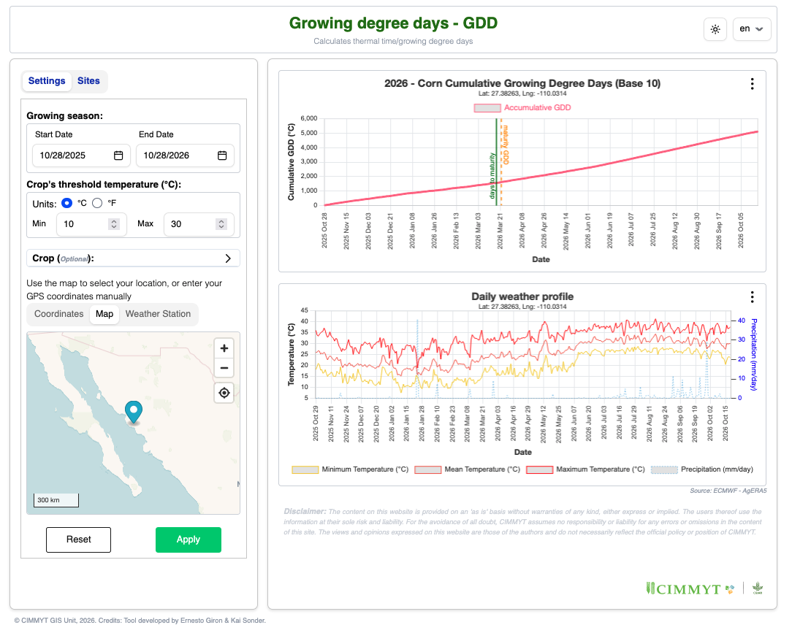

<p align="center">
    
</p>

<p align="center">
  <!-- <a href="https://github.com/egiron/GDD/actions"></a> -->
  <a href="https://opensource.org/licenses/"></a>
  
</p>

# Growing degree days (GDD)

A web-based tool for exploring and estimating thermal time/growing degree days using agERA5 datasets.

## Quick Start

Just go to the **[egiron.github.io/GDD/](https://egiron.github.io/GDD/)**

### Installation

1. **Clone the Repository**:

```sh
git clone https://github.com/egiron/GDD.git
cd GDD
```

2. **Install dependencies**

Install dependencies with `npm install`.

```sh
npm run install
```

To recreate this project with the same configuration from scratch:

```sh
# recreate this project
npx sv@0.17.0 create --template minimal --types ts --add prettier eslint vitest="usages:unit,component" tailwindcss="plugins:typography,forms" sveltekit-adapter="adapter:static" --install npm webapp
```

### Developing

Once you've created a project and installed dependencies with `npm install` (or `pnpm install` or `yarn`), start a development server:

```sh
npm run dev

# or start the server and open the app in a new browser tab
npm run dev -- --open
```

### Building

To create a production version of your app:

```sh
npm run build
```

You can preview the production build with `npm run preview`.

> To deploy your app, you may need to install an [adapter](https://svelte.dev/docs/kit/adapters) for your target environment.

## How to Use the Tool

### 1. Hosted version

Open [egiron.github.io/GDD/](https://egiron.github.io/GDD/) to explore current version of GDD.

### 2. Select a range of dates for growing season

Define the start and end dates in MM/DD/YYYY format for the growing period

### 4. Define a crop's threshold temperature

- Select the units in Celsius degrees or Fahrenheit (°C or °F)
- Select the minimum and maximum values for the threshold

Another way to select the thresholds is using a predefined boundaries by selecting a crop/insect/disease to automatically setup the threshold temperatures.

### 5. Crop Maturity (_optional_)

Define thresholds such as _Maturity GDD_ and _Days to Maturity_ to visualize them in the final charts.

### 6. Explore a location

Use the map to select your location, or enter your GPS coordinates manually.

The geographic coordinates (_Latitude/Longitude_) should be in decimal degrees in WGS84.

### 7. Apply GDD to a Weather Satation (_optional_)

Upload your own station daily data to apply GDD

### 8. Generate the Interactive Figures

Click `Apply` to execute the GDD algorithm. This may take a couple of minutes.

### 9. Export the Results

Export the raw weather data and Figures from each run in DSSAT, APSIM, CSV, TXT, XLSX, PNG, and JPG formats

## License

**MIT License**

Copyright (c) 2026 

Permission is hereby granted, free of charge, to any person obtaining a copy
of this software and associated documentation files (the "Software"), to
deal in the Software without restriction, including without limitation the
rights to use, copy, modify, merge, publish, distribute, sublicense, and/or
sell copies of the Software, and to permit persons to whom the Software is
furnished to do so, subject to the following conditions:

The above copyright notice and this permission notice shall be included in
all copies or substantial portions of the Software.

THE SOFTWARE IS PROVIDED "AS IS", WITHOUT WARRANTY OF ANY KIND, EXPRESS OR
IMPLIED, INCLUDING BUT NOT LIMITED TO THE WARRANTIES OF MERCHANTABILITY,
FITNESS FOR A PARTICULAR PURPOSE AND NON-INFRINGEMENT. IN NO EVENT SHALL THE
AUTHORS OR COPYRIGHT HOLDERS BE LIABLE FOR ANY CLAIM, DAMAGES OR OTHER
LIABILITY, WHETHER IN AN ACTION OF CONTRACT, TORT OR OTHERWISE, ARISING
FROM, OUT OF OR IN CONNECTION WITH THE SOFTWARE OR THE USE OR OTHER DEALINGS
IN THE SOFTWARE.

Copyright (c) 2026 International Maize and Wheat Improvement Center (CIMMYT)

## Authors

- **Ernesto Giron** — Primary development and design
- **Kai Sonder** — Project Leader

## Citation

```bibtex
@software{gdd2026,
  title={GDD: Growing degree days Explorer},
  author={Giron, E. and Sonder, Kai},
  year={2026},
  url={https://github.com/egiron/GDD}
}
```
